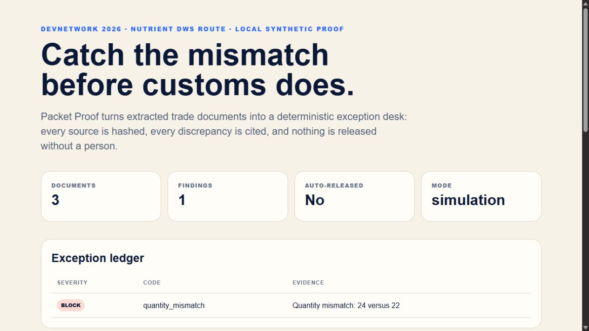

# Packet Proof

Packet Proof is an auditable exception desk for trade-document packets. Nutrient DWS performs the core PDF extraction; deterministic local rules compare a commercial invoice, packing list, and certificate of origin; a human owns the release decision.

The default demo uses fictional PDFs and recorded synthetic extraction fixtures. It makes **zero Nutrient API calls**. Sanitized responses from a separate authorized live run are retained under `artifacts/live/`.

## See the result



The demo detects **24 units on the invoice versus 22 on the packing list** and returns `human_review_required`. The release decision stays with a person.

[Demo video](https://youtu.be/AgYh_pTIXpI) · [Sample report source](artifacts/packet-report.html) · [Recorded result](artifacts/packet-result.json) · [Dated verification record](VERIFICATION.md)

## Architecture

PDFs → Nutrient extraction or recorded fixtures → typed document models → deterministic reconciliation → JSON and HTML evidence for human review.

The implementation separates [provider integration](packet_proof/provider.py), [models](packet_proof/models.py), [comparison rules](packet_proof/engine.py), and [reporting](packet_proof/report.py). Tests exercise validation, mismatch handling, stable hashes, HTML escaping, and provider failures.

## Local demo

```bash
python -m venv .venv
.venv/Scripts/python -m pip install -e ".[dev]"
.venv/Scripts/python tools/build_demo_pdfs.py
packet-proof demo --pdf-dir output/pdf --fixture-dir fixtures/extractions --output-dir artifacts
```

The expected result is `human_review_required`: the commercial invoice states 24 AX-410 units while the packing list states 22. Nothing is automatically released.

## Live Nutrient extraction

Set `NUTRIENT_API_KEY` on the server, review the three synthetic PDFs, and use the explicit two-part gate:

```bash
packet-proof extract-live --pdf-dir output/pdf --output-dir artifacts/live \
  --execute --confirm "PROCESS THREE SYNTHETIC DOCUMENTS"
```

The adapter posts each PDF to the official `https://api.nutrient.io/build` endpoint with JSON-content output requesting plain text, structured text, key-value pairs, and tables. Do not use real commercial or personal documents without authority and an appropriate data-processing review.

## Boundaries

- Every input is SHA-256 hashed and recorded with its extraction provider.
- Required fields, decimal values, and confidence values are validated.
- Packet identity, supplier, SKU, quantity, origin, and invoice arithmetic are checked deterministically.
- Any mismatch or field below 90% confidence requires human review.
- The software never auto-releases, signs, transmits, amends, or represents a customs decision.
- Provider uncertainty fails closed; live extraction has no automatic retry.

## Verification

```bash
ruff format --check .
ruff check .
pytest --cov=packet_proof --cov-report=term-missing
python -m pip check
```

The retained live evidence can be rebuilt without credentials:

```bash
python tools/replay_live_responses.py
```

See [VERIFICATION.md](VERIFICATION.md) for dated test, coverage, live extraction, video, and submission evidence. [SUBMISSION.md](SUBMISSION.md) retains the submission checklist.

## Project contact

Built by [Blaz Algo Systems](https://blazalgosystems.netlify.app/proof-of-work/). For Python/API reliability, document automation, or a scoped integration, see the [service menu](https://blazalgosystems.netlify.app/services/).
